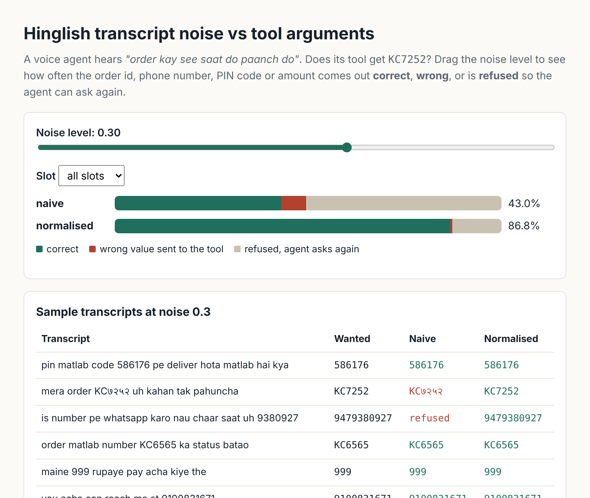

# mixslot

When a caller says *"mera order kay see saat do paanch do"*, does the voice agent's
`lookup_order` tool get `KC7252`?

mixslot measures that. It generates Hinglish utterances that carry order ids, phone
numbers, PIN codes and amounts, corrupts them the way speech recognition corrupts spoken
numbers, and checks whether each extractor returns the right value, a **wrong** value, or
**refuses** so the agent can ask again.

**Interactive version:** https://yashere69.github.io/mixslot/



## Why this matters

Vendor-published Hinglish speech-to-text comparisons put word error rates for global ASR
models in the high 20s to mid 30s percent on code-switched speech. Those numbers are reported in
words. A voice agent doesn't care about words; it cares whether the 10 digits passed to
`send_whatsapp(phone=...)` are the right 10 digits. One misheard digit in an order id
fails the whole tool call, or worse, finds someone else's order.

Benchmarks stop at the transcript. This one starts there.

## Run it

```bash
pip install git+https://github.com/yashere69/mixslot
mixslot bench --levels 0,0.1,0.3,0.5
mixslot extract phone "mera number nau aath double saat chhe paanch chaar teen do ek hai"
```

No API key needed. To compare a real model as a third extractor:
`MIXSLOT_API_KEY=… mixslot bench --endpoint <openai-compatible-url> --model <name>`.

## Results

Two measurements, and they disagree in a way worth reading before either.

**On a real recogniser** (Whisper base on Hindi TTS speech, 576 held-out transcripts,
[results/asr.md](results/asr.md)): the normaliser gets 11.1% of values right against a plain
regex's 6.6%, and passes on a wrong value 11.6% of the time against 12.3%. It recovers more
values, but it does not make wrong values rarer, because most wrong values come from digits
the recogniser never wrote down. Read numbers back to the caller.

**On the synthetic noise model** (400 utterances, seed 11), which is what the page and the
table below show:

| Noise | Naive: correct / wrong / refused | Normalised: correct / wrong / refused |
|---|---|---|
| 0.0 | 400 / 0 / 0 | 400 / 0 / 0 |
| 0.1 | 302 / 16 / 82 | 388 / 0 / 12 |
| 0.3 | 172 / 26 / 202 | 347 / 2 / 51 |
| 0.5 | 83 / 26 / 291 | 321 / 5 / 74 |

Full table in [results/curve.json](results/curve.json); `python tools/build_site.py`
regenerates it along with the page.

The **wrong** column matters more than the correct one. A refusal costs one more turn
("could you repeat the order number?"). A wrong value costs a wrong refund, a message to a
stranger's phone, or a cancelled order that wasn't theirs. On synthetic noise the
normaliser's validator cuts wrong values from 26 to 2 at noise 0.3, because a 9-digit
"phone number" or a phone number starting with 5 is refused, not passed on. The synthetic
model mostly drops or rewrites digits in ways the validator can see, which is why it's
optimistic; the recogniser above produces wrong values that still look valid.

## Use it in front of your own tools

The normaliser is the part worth taking. Your order ids won't look like the demo's
`KC7252`, so give it your own pattern:

```python
from mixslot.extract import extract

extract("mera order O R D double four one zero hai", r"ORD\d{4}")   # 'ORD4410'
extract("order number ORD44101", r"ORD\d{4}")                       # None: ask again
```

```bash
mixslot extract custom "order O R D 4 4 1 0" --pattern 'ORD\d{4}'
```

`extract` normalises first: digit words in English, romanised Hindi or Devanagari, "double"
and "triple", spelled letters ("O R D", "kay see"), Devanagari digits, fillers inside
numbers. It returns a match only if nothing touches it on either side, and returns `None`
rather than a near miss. Put it between the transcript and the tool call, and treat `None`
as "could you repeat that?".

Spelled letters are only joined when a number follows them, and "are", "you", "why" and
"oh" aren't treated as letter names, because in Hinglish calls they're nearly always just
words.

## Prior art

Inverse text normalisation (turning "nine eight seven" into 987) is well covered. NVIDIA's
[NeMo text processing](https://docs.nvidia.com/nemo-framework/user-guide/latest/nemotoolkit/nlp/text_normalization/wfst/wfst_text_normalization.html)
does it with WFST grammars. [indic-itn](https://pypi.org/project/indic-itn/) handles Hindi
number words well, including compositional amounts ("चौदह सौ निन्यानवे" → ₹1,499), which
mixslot doesn't. mixslot is narrower and aimed at tool arguments: spelled codes (`के सी`,
`kay see`), digits in any of three scripts and two languages, and refusing a value that
fails the slot's validator instead of passing it on.

## The noise model

Each operator fires with probability proportional to `level` on each eligible token:

| Operator | Example |
|---|---|
| digits spoken as words, Hindi or English, switching mid-number | `9876` → `nau aath seven six` |
| repeats said with "double" | `77` → `double saat` |
| letters spelled out | `KC7252` → `kay see 7252`, `K C 7252` |
| digit groups split by spaces | `9876543210` → `98765 43210` |
| fillers inside numbers | `nau aath haan saat` |
| Devanagari digits in the transcript | `KC७२५२` |
| a digit dropped entirely | `9876543210` → `987654310` |

**Checked against a real recogniser, the model is optimistic.**
[results/asr.md](results/asr.md) runs Whisper base on Hindi TTS speech: two voices, clean,
telephone-band and noisy, with a dev set and a held-out set. Whisper writes Hindi in three
scripts, hyphenates digits, drops some and hallucinates under noise, and the extractors do
worse there than at the synthetic model's harshest level. On the held-out transcripts the
normaliser gets 11.1% of values right against the regex's 6.6%, with wrong values at
11.6% against 12.3%. Most values can't be recovered at all. So `level` is still a knob,
not a WER. `mixslot eval your-transcripts.jsonl` measures a recogniser that matters to you
and says which synthetic level it resembles. Labelled audio from real calls (the HiACC
corpus is one candidate, subject to its licence) is the remaining step.

## The normaliser

`mixslot.extract.normalise` rebuilds numbers before any regex sees them:

1. Devanagari digits → ASCII (one-to-one, so nothing shifts)
2. `kay see` / `K C` → `KC`
3. Walks tokens; digit words and digit groups join one run, `double`/`triple` repeat the
   next digit, fillers between digits are dropped and fillers elsewhere are kept
4. Then the slot regex runs, and the value must pass the slot's validator (`KC` + 4 digits;
   10 digits starting 6–9; 6-digit PIN not starting 0) or it's refused

It's around 60 lines and has no model in it. That's the point: in a voice agent, this
belongs between the transcript and the LLM's tool call, where it's cheap, deterministic and
testable.

One detail from writing the tests: Python's `\d` matches Devanagari digits, so a regex alone
happily passes `KC७२५२` to the tool. The naive column counts that as wrong, and a real
database lookup would agree.

## Limits

- **Naive is a floor, not an LLM.** A model reading `nau aath saat…` will do better than a
  regex; use `--endpoint` to measure how much. The normaliser is still useful in front of a
  model, since it hands the model clean digits.
- The utterance templates are short and single-slot. Real calls carry several numbers in one
  turn ("order KC7252, number 98…"), which makes slot confusion possible. That isn't modelled.
- The synthetic benchmark is text-only noise. The audio check uses TTS speech and one
  small recogniser, not callers. Real calls and production recognisers will differ in
  both directions.
- Amounts said as Hindi number words aren't composed ("दो सौ निन्यानवे" is not read as
  299). When a recogniser half-transcribes one, the normaliser can pass on a partial
  amount, so read amounts back to the caller. Composition was left out on evidence: of the
  132 held-out amount transcripts from Whisper base, 5 contain a word like "hazaar" or
  "thousand", and all 5 are hallucinations a composer couldn't fix. It's worth adding with
  a recogniser that writes amounts out as words; [indic-itn](https://pypi.org/project/indic-itn/)
  already does the composing.

Stable: `normalised()`/`normalise()`, the slot validators and the `eval` input format.
Experimental: the noise operators and their rates.

MIT licensed.
